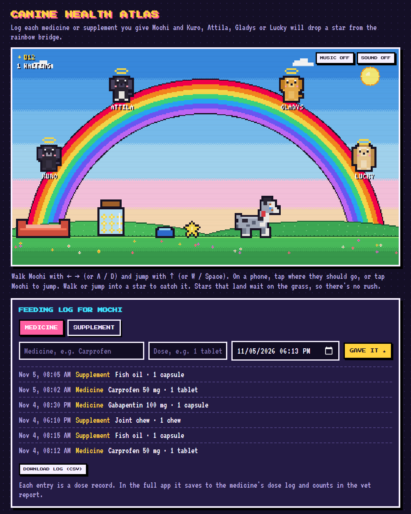

# Canine Health Atlas

**AI Dev Tools Zoomcamp 2026, Project 2.** A care record for one dog that turns everyday logs into a clinical report an owner can bring to the vet.

**Status:** specified, not built yet. The [spec](./docs/spec.md) is the source of truth; a playable prototype of the star garden is in [`game/`](./game/).

## Problem

Owners of ageing or chronically ill dogs keep care information in their heads, group chats and photo galleries, then rebuild it from memory at the vet. Reconstructing one dog's last years ([Kuro's archive](https://github.com/nghuixin/os-kuro-archives)) showed three costly gaps: supplies ran out unnoticed, nothing measured how he felt, and observations were scattered across chats.

## What it will do

- **Log** observations, medicine doses, weight and a weekly quality-of-life check-in (HHHHHMM) as they happen.
- **Track** when each medicine runs out.
- **Report:** a printable, clinical one-page vet report for any period: medicines and doses given, weight change, quality-of-life scores, observations by category and the owner's questions. Owner-recorded facts only, never a diagnosis.
- **Star garden:** an optional pixel-art corner on the Today page with a feeding log for medicines and supplements. Each dose logged there is a real record that shows up in the vet report. Each successful save drops a star from a rainbow bridge where Kuro, Attila, Gladys and Lucky sit, for your dog to catch. Stars reward logging, never results.

## Planned stack

React + Vite · FastAPI · SQLAlchemy with SQLite locally and Neon Postgres in the cloud · Docker Compose · GitHub Actions deploying to Google Cloud Run (dev automatically, production after approval, with revision rollback) · OpenTelemetry, Grafana and Google Cloud Observability · an alert on failed saves and an on-call agent that opens a fix PR but never deploys.

## Try the prototype

Open [`game/index.html`](./game/index.html) in a browser. Walk with ← →, jump with ↑ or Space, and log something to make a star drop. Prototype data stays in your browser.

## Docs

| | |
|---|---|
| [Spec](./docs/spec.md) | Problem, features with acceptance criteria, data model, API, testing, deployment, CI/CD, observability, alerting, on-call agent, agent team |
| [MVP plan](./docs/atlas/mvp-plan.md) | How the idea was narrowed down from the full Atlas |
