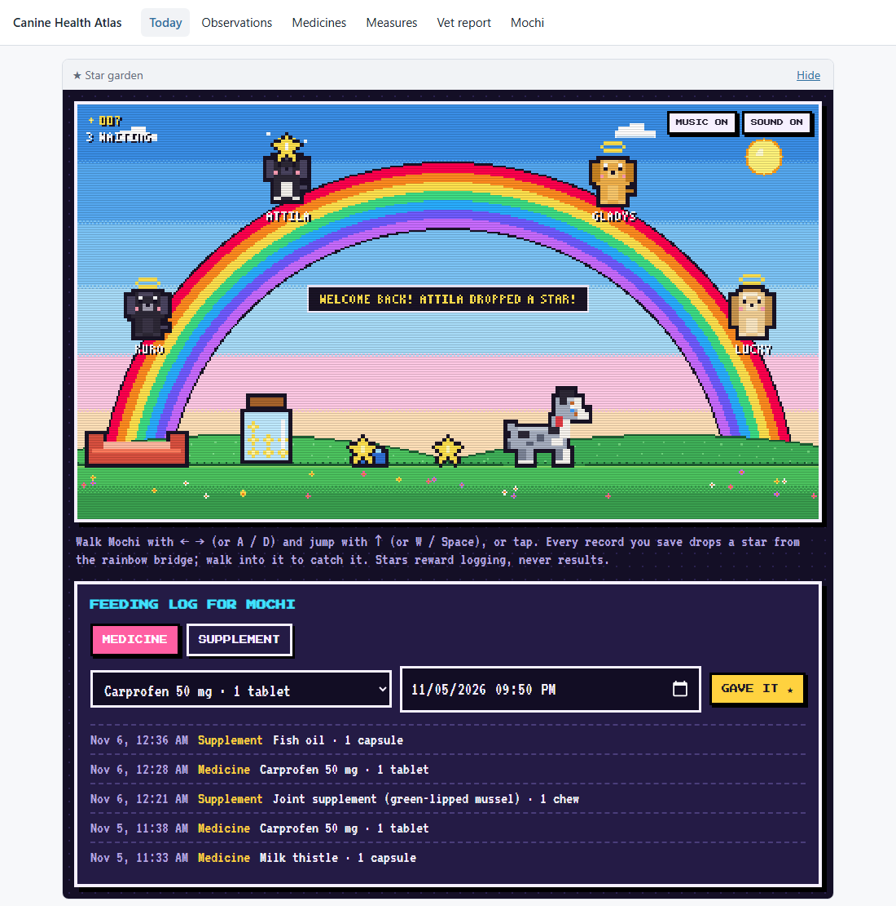

# Canine Health Atlas

**AI Dev Tools Zoomcamp 2026, Project 2.** A care record for one dog that turns everyday logs into a clinical report an owner can bring to the vet.

**Status:** built and tested locally. Cloud deployment (Google Cloud Run + Neon) is ready to switch on after the one-time setup in [docs/deployment.md](./docs/deployment.md).



## Problem

Owners of ageing or chronically ill dogs keep care information in their heads, group chats and photo galleries, then rebuild it from memory at the vet. Reconstructing one dog's last years ([Kuro's archive](https://github.com/nghuixin/os-kuro-archives)) showed three costly gaps: supplies ran out unnoticed, nothing measured how he felt, and observations were scattered across chats.

## What it does

- **Log** observations (with optional keyword-based Analyze), medicine doses, weight and a weekly quality-of-life check-in (HHHHHMM) as they happen.
- **Track** when each medicine runs out; anything within 7 days is highlighted on Today.
- **Report:** a printable, clinical vet report for any period (since the last visit by default): medicines with doses given vs expected, starts and stops, weight change, every quality-of-life item, observations by category and the owner's questions. Owner-recorded facts only, never a diagnosis.
- **Star garden:** an optional pixel-art corner on Today with a feeding log for medicines and supplements. Each dose logged there is a real record that counts in the vet report. Every successful save drops a star from a rainbow bridge where Kuro, Attila, Gladys and Lucky sit, for your dog to catch. Stars reward logging, never results.

## Run it

Requirements: Docker, or Python with [uv](https://docs.astral.sh/uv/) and Node 22.

```bash
make up            # whole system in Docker (API + UI + Postgres) on http://localhost:8000
make seed-demo     # optional: load a demo dog
```

Without Docker: `make install`, then `make run` (API on :8000, SQLite) and `make dev` (UI on :5173).

Tests: `make test` (backend + frontend), `make test-all` (adds integration tests against a throwaway Compose stack).

## How it's built

React + Vite + TypeScript · FastAPI · SQLAlchemy + Alembic (SQLite locally, Postgres in Compose, Neon in the cloud) · one Docker image serving UI and API · GitHub Actions deploying to Google Cloud Run (dev automatically, production after approval, revision rollback) · OpenTelemetry traces, Prometheus metrics and JSON logs sharing a trace ID (Grafana locally, Google Cloud Observability in production) · a `RecordSaveFailing` alert and an on-call agent that opens a fix PR but never deploys.

The public deployment holds demo data only: there is no login in this MVP.

## Docs

| | |
|---|---|
| [AGENTS.md](./AGENTS.md) | Start here: layout, commands, rules |
| [Spec](./docs/spec.md) | Problem, features with acceptance criteria, data model, API, testing, deployment, observability, on-call |
| [Deployment](./docs/deployment.md) | Google Cloud Run + Neon setup, CI/CD, rollback |
| [Observability](./docs/observability.md) | Signals, dashboard, alert runbook, demos |
| [Process](./docs/process.md) · [Permissions](./docs/permissions.md) | Agent team loop and what each agent may touch |
| [Decision log](./docs/tasks.md) · [Criteria log](./docs/criteria-log.md) | Choices made, and evidence for each course criterion |
| [MVP plan](./docs/atlas/mvp-plan.md) | How the idea was narrowed down from the full Atlas |
