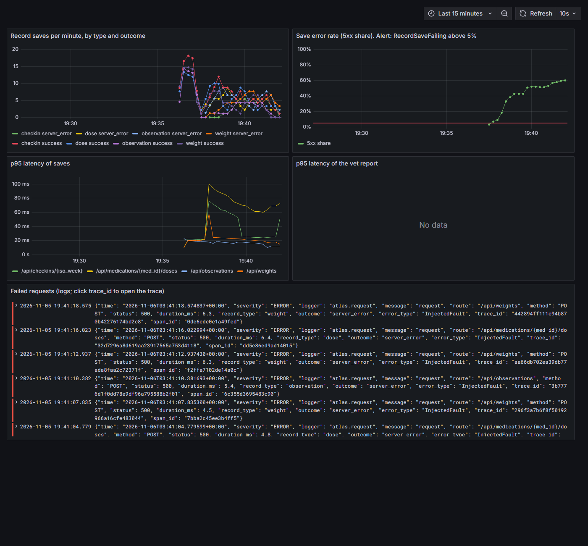

# Observability, alerting and the on-call demo

Spec §9, §15–17. The key user journey is **saving a record** (observation, dose, weight, check-in): that is the moment the owner's care becomes data. The second is opening the vet report.

## Signals

| Signal | What the API emits | Local (`make up-obs`) | Production |
|---|---|---|---|
| Traces | OpenTelemetry: one server span per request (FastAPI) with a child span per SQL statement (SQLAlchemy) | Tempo, in Grafana | Cloud Trace |
| Metrics | `atlas_record_saves_total{type, outcome}`; `atlas_http_request_duration_seconds{route, method}` | Prometheus scrapes `/metrics`; Grafana dashboard | Log-based metric `atlas_record_saves` from the request logs |
| Logs | One JSON line per API request: `time, severity, route, method, status, duration_ms, record_type, outcome, error_type, trace_id, span_id` | Promtail → Loki, in Grafana | Cloud Logging; `logging.googleapis.com/trace` links each line to Cloud Trace |

**Correlation:** every log line carries the trace ID of its request. In Grafana, a log line's `trace_id` opens the trace in Tempo, and a trace links back to its log lines. In Google Cloud, Logs Explorer shows a trace icon on each line.

**No customer data (spec §9):** telemetry never contains request bodies, observation text, summaries, the dog's name, medicine names or notes, and never exception messages (database errors can echo values); only the exception class name. Routes are recorded as templates (`/api/medications/{med_id}/doses`), so IDs in paths don't become labels. `backend/tests/test_telemetry.py` sends a marker string through every write endpoint and asserts it never appears in logs, spans or metrics.

## Dashboard



*During `make alert-demo`: saves by type and outcome, the 5xx share crossing the 5% alert line, p95 latencies, and failed requests with their trace IDs.*


`make up-obs`, then open http://localhost:3000 (ports can be moved in `.env`, see `.env.example`, if another project already uses them) → *Canine Health Atlas: record saves*. Panels: saves per minute by type and outcome; save error rate against the 5% alert line; p95 latency of saves; p95 latency of the vet report; failed requests from Loki, with clickable trace IDs.

## RecordSaveFailing

| | |
|---|---|
| Condition | More than 5% of record saves return 5xx over 2 minutes, sustained for 1 minute |
| Why | The owner's care stops being recorded: the product's core job |
| Local | Prometheus rule in `ops/observability/alerts.yml` (see it at http://localhost:9090/alerts) |
| Production | Cloud Monitoring PromQL policy on the log-based metric (`ops/gcp/setup-monitoring.sh`), email channel, optional Pub/Sub channel for the on-call agent |

There are deliberately no CPU or memory alerts: they don't describe what the owner experiences.

### RecordSaveFailing runbook

1. **Mitigate first.** If it started after a deploy, run the `rollback` workflow (Actions → rollback → `previous`). Traffic moves back in seconds.
2. Open the dashboard: which `type` is failing? All types at once points at the database (check `/healthz`, Neon status); one type points at its code path.
3. Open a failing log line's trace: the span that errored, and the `error_type` on the log line, show where.
4. The on-call agent will usually have opened a PR with a reproduction test and a fix. Review it like any other PR; merging it goes through the normal pipeline (dev, then your approval for production).

## Demos

### The alert fires (fault injection)

```bash
make up-obs          # app, Prometheus, Tempo, Loki, Grafana
make seed-demo       # optional: the demo dog
make alert-demo      # restarts the API with FAULT_SAVE_500_RATE=0.5 and sends 4 minutes of saves
```

About half the saves fail. After about 2–3 minutes `RecordSaveFailing` is *pending*, then *firing* at http://localhost:9090/alerts. `make alert-demo-off` restores normal behaviour.

### The on-call agent fixes a real bug

```bash
DEMO_BUG=checkin_total make up-obs     # turns on a code path with a planted bug
make oncall-watch                       # in another terminal: the poller
cd backend && uv run python ../scripts/traffic.py --minutes 5
```

The planted bug is in `backend/app/logic.py` (`_weighted_total`): it divides by each check-in item, so any item scored 0 raises `ZeroDivisionError`. Traffic includes zero scores, check-in saves start failing, and the alert fires. The poller writes a brief with the failing routes and trace IDs and starts the agent in a new worktree. The agent must fix the code (not just switch the flag off), add a regression test for a 0 score, and open a PR. See `.agents/agents/oncall.md` and docs/permissions.md.

To preview the poller without waking an agent: `cd backend && uv run python ../scripts/poll_alerts.py --once --dry-run`.
